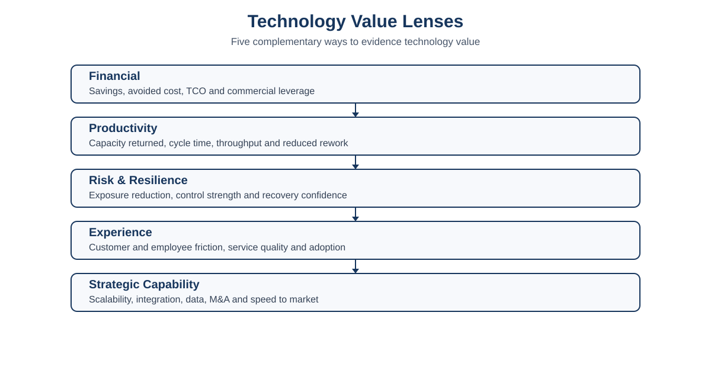

# Technology Financial Management & Value Realisation

**Showing where technology money goes, how investments are prioritised, and what value they create beyond the IT budget.**

Technology functions are often measured primarily through expenditure: budget variance, licence cost, infrastructure spend, project cost and headcount.

Those measures matter, but they are incomplete.

> **Technology should be financially disciplined without allowing its value to be reduced to whether the IT budget went up or down.**

Much of enterprise technology is OPEX-driven. Cloud, SaaS, managed services, cyber controls, connectivity, support, people and platform operations can increase or remain visible inside the IT cost base even when the value they create appears elsewhere in the organisation.

This framework connects:

**Business Need → Baseline → Options → Investment → Delivery → Adoption → Benefit → Review**

It provides a practical way to manage the P&L and budget responsibly while also making financial, productivity, risk, experience and strategic value visible.

---

## The five technology value lenses

| Lens | Typical evidence |
|---|---|
| **Financial** | savings, avoided cost, revenue support, TCO reduction, vendor leverage |
| **Productivity** | hours returned, cycle-time improvement, throughput, automation, reduced rework |
| **Risk & Resilience** | reduced exposure, recovery improvement, control uplift, avoided incidents |
| **Experience** | customer or employee experience, service quality, adoption, friction reduction |
| **Strategic Capability** | scalability, integration, M&A readiness, data capability, speed to market |

The framework deliberately avoids forcing every investment into a fictional dollar ROI. Different investments create value in different ways.

---

## The financial management cycle

**Plan → Run → Optimise → Invest → Realise → Reallocate**

1. **Plan** — establish budget, demand, commitments and cost drivers.
2. **Run** — manage the technology estate and forecast accurately.
3. **Optimise** — remove waste, duplication and avoidable cost.
4. **Invest** — prioritise limited funding against business value and risk.
5. **Realise** — measure whether expected benefits occurred.
6. **Reallocate** — feed evidence back into the next planning cycle.

---

## Repository contents

### Core documentation
1. [Framework Overview](docs/01-framework-overview.md)
2. [Technology Cost Model](docs/02-technology-cost-model.md)
3. [Budget, Forecasting & P&L Discipline](docs/03-budget-forecasting-pl-discipline.md)
4. [The Five Value Lenses](docs/04-five-value-lenses.md)
5. [Investment Prioritisation](docs/05-investment-prioritisation.md)
6. [Technology Business Cases & ROI](docs/06-business-cases-and-roi.md)
7. [Benefits Realisation](docs/07-benefits-realisation.md)
8. [Value Scorecard & Executive Reporting](docs/08-value-scorecard-executive-reporting.md)
9. [Worked Example: Vendor Consolidation](docs/09-worked-example-vendor-consolidation.md)
10. [Worked Example: Security & Resilience Investment](docs/10-worked-example-security-resilience.md)
11. [FinOps, SaaS & Cost Optimisation](docs/11-finops-saas-cost-optimisation.md)
12. [Article Draft](docs/12-article-it-is-more-than-a-cost-centre.md)

### Templates
- [Technology Cost Baseline](templates/01-technology-cost-baseline.md)
- [Budget & Forecast Review](templates/02-budget-forecast-review.md)
- [Investment Value Case](templates/03-investment-value-case.md)
- [Portfolio Prioritisation](templates/04-portfolio-prioritisation.md)
- [Benefits Realisation Register](templates/05-benefits-realisation-register.md)
- [Technology Value Scorecard](templates/06-technology-value-scorecard.md)
- [Executive Value Narrative](templates/07-executive-value-narrative.md)

### Worked examples
- [Vendor Consolidation Example](examples/vendor-consolidation-example.md)
- [Security Investment Example](examples/security-investment-example.md)

### Diagrams
- [Technology Value Lenses](diagrams/technology-value-lenses.svg)
- [Financial Management Cycle](diagrams/financial-management-cycle.svg)
- [Investment to Value](diagrams/investment-to-value.svg)
- [Technology Value Scorecard](diagrams/technology-value-scorecard.svg)

Editable Mermaid-style source files are included under [`diagrams/source/`](diagrams/source/).

---

## Core principles

1. **Budget discipline is necessary, but not the definition of value.**
2. **Cost and value should be discussed together.**
3. **Baseline before business case.**
4. **Total cost before purchase price.**
5. **Capability before product.**
6. **Benefits should have an owner outside IT where appropriate.**
7. **Risk reduction should not be dressed up as fake revenue.**
8. **Operational adoption is part of the investment case.**
9. **Investment decisions should be portfolio decisions, not isolated requests.**
10. **Evidence from realised benefits should influence future funding.**

---

## Positioning

This framework is intended for technology leaders, CIOs, Heads of IT, portfolio leaders and business stakeholders who need to make technology economics more visible without reducing technology to a cost-centre narrative.

It is deliberately vendor-neutral and organisation-neutral.

---

## Release

Current release: **v1.0.0 — Stable Reference**

See [v1.0.0 release notes](release-notes/v1.0.0.md).

---

## Licensing

Documentation, diagrams and templates are CC BY 4.0. Executable code/scripts, if added, are MIT licensed.

---

## Author

**Rakesh Randeria**  
Technology Executive — Strategy, Transformation, Cybersecurity, AI & Digital Enablement

Professional site: https://rakeshranderia.com.au/  
GitHub: https://github.com/rakeshranderia
